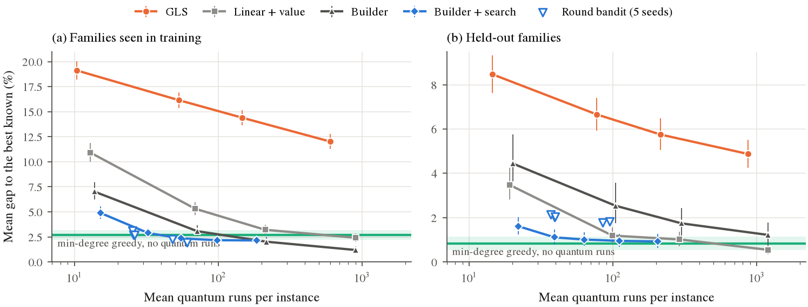

# Learned piece selection for neutral-atom quantum optimization

Pasqal's neutral-atom processors solve maximum independent set natively, but only on small unit-disk graphs. Larger graphs are split with the divide-and-conquer heuristic of [Cazals et al., Phys. Rev. A 112, 062416 (2025)](https://arxiv.org/abs/2508.06130), which grows pieces that fit a fixed 61-trap layout, solves them on the processor, and removes each solution with its neighbours. Fixed greedy rules (GLS) decide how pieces are grown, which are solved and which partial solutions are kept. This repository replaces those rules with learned models and compares them with GLS, an exact solver and min-degree greedy, with exact piece solutions and on Pasqal's EMU_MPS emulator.

On 520 fresh instances, the best models lower the mean gap of GLS from 14.4% to about 2% on graph families seen in training and from 5.8% to about 1% on held-out families. Min-degree greedy, which uses no quantum runs, does about as well, and at these piece sizes random bitstrings with classical repair do about as well as the emulator, so this is not a quantum-advantage result.



## Paper

[`paper/main.pdf`](paper/main.pdf) describes the method and the results.

## Install

```bash
git clone https://github.com/hbofz/learned-gls.git
cd learned-gls
uv sync
uv run pytest -q
```

Python 3.12. Set `OMP_NUM_THREADS=1` when running several workers.

## Reproduce the paper

```bash
uv run python paper/figs.py          # every figure and pooled number, from results/eval
cd paper && latexmk -pdf main.tex    # the PDF (needs REVTeX 4.2)
```

## Usage

Run methods on a few generated graphs:

```bash
uv run python -m learned_selection.bench --family er --params p=0.25 --n 100 --seeds 0-1 \
    --methods gls,bld-h3+dgin-h4+dgin-h5,greedy-mindeg,exact --widths 4,2,10 --restarts 1 --out results/demo.jsonl
```

Each run appends one JSON record (set size, gap, quantum runs, timing, commit), and a rerun skips what is already in `--out`. Other entry points, each with `--help`:

| Module | Purpose |
|---|---|
| `learned_selection.curves` | gap against quantum runs, with bootstrap intervals and plots |
| `learned_selection.emuval` | whole decompositions with the exact, random or cloud piece solver |
| `learned_selection.calibrate` | the exact stand-in against the cloud emulator on single pieces |
| `learned_selection.train`, `dagger`, `builder`, `pg`, `bandit`, `gfn`, `az`, `evolve` | training |

## Methods

| Method string | Model |
|---|---|
| `gls` | Pasqal's rules (baseline) |
| `lin-h2h4+sage-h5` | linear rankers with a graph-network value model |
| `dgin-h2h4h5` | graph networks retrained on their own decisions (DAgger) |
| `bld-h3+dgin-h4+dgin-h5` | learned piece builder |
| `bld-h3+sage-h4+dsage-h5+mcts-c0.5` | builder inside a PUCT tree search (budget set by `--widths 4,2,100`) |
| `bandit-r` | per-round choice of the search widths |
| `greedy-mindeg`, `exact` | classical references |

Trained weights are in `models/`.

## Layout

- `learned_selection/`: the decomposition engine, models, training, benchmark and emulator client
- `vendor/pasqal_docking/`: Pasqal's GLS code, unchanged, with its licence; the tests check the engine against it
- `models/`: trained weights
- `results/eval/`: every record behind the reported numbers; `results/raw/`: the saved emulator answers; `results/calibration*.jsonl`: single pieces solved by the stand-in and by the emulator
- `paper/`: the paper, its figure script and figures
- `tests/`: the test suite

## Notes

- Replay records on the machine that made them: the graph networks can break ties differently across machines. Emulator runs replay offline from the saved answers with `--replay`.
- New emulator jobs need a Pasqal cloud account: set `PASQAL_PROJECT_ID`, and put the username and password on two lines of `~/.config/pasqal/login` (mode 600) or, on macOS, in the Keychain under `pasqal-cloud`.
- AI was utilized in the development of this project.

## History

This repository is a clean rebuild of the original development repository, published as a single commit. It holds the code, models and records behind the paper; the development history, including earlier experiments the paper does not use, is kept in a private archive.

## Citation

```bibtex
@misc{azzam2026learned,
  title  = {Learned piece selection for divide-and-conquer maximum independent set on neutral-atom arrays},
  author = {Azzam, Hamzah},
  year   = {2026},
  url    = {https://github.com/hbofz/learned-gls}
}
```

The baseline heuristic: P. Cazals, A. Sorondo, V. Onofre, C. Dalyac, W. da Silva Coelho and V. Vitale, Quantum optimization on Rydberg-atom arrays with arbitrary connectivity: Gadget limitations and a heuristic approach, *Phys. Rev. A* 112, 062416 (2025). Pasqal's implementation is from [pasqal-io/Molecular-Docking](https://github.com/pasqal-io/Molecular-Docking) (Garrigues et al., arXiv:2508.18147).

## Licence

MIT, except `vendor/pasqal_docking/`, which keeps Pasqal's licence.
